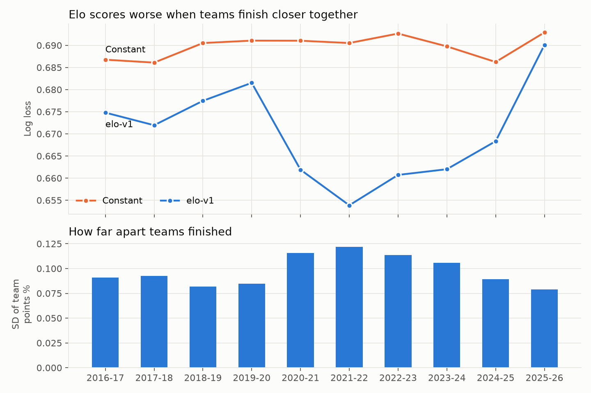
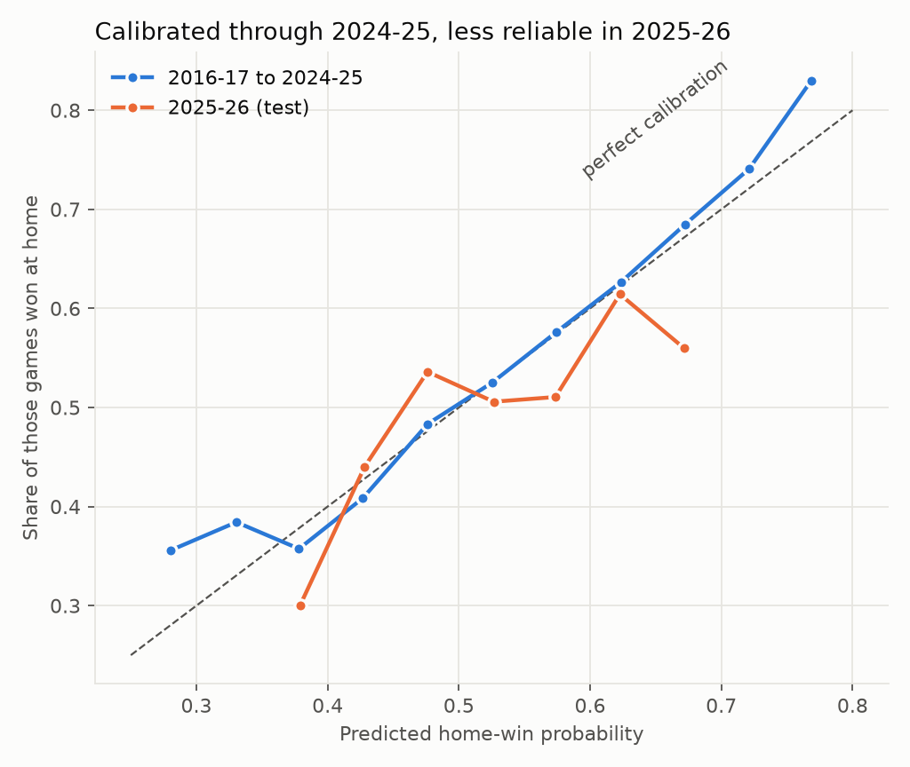
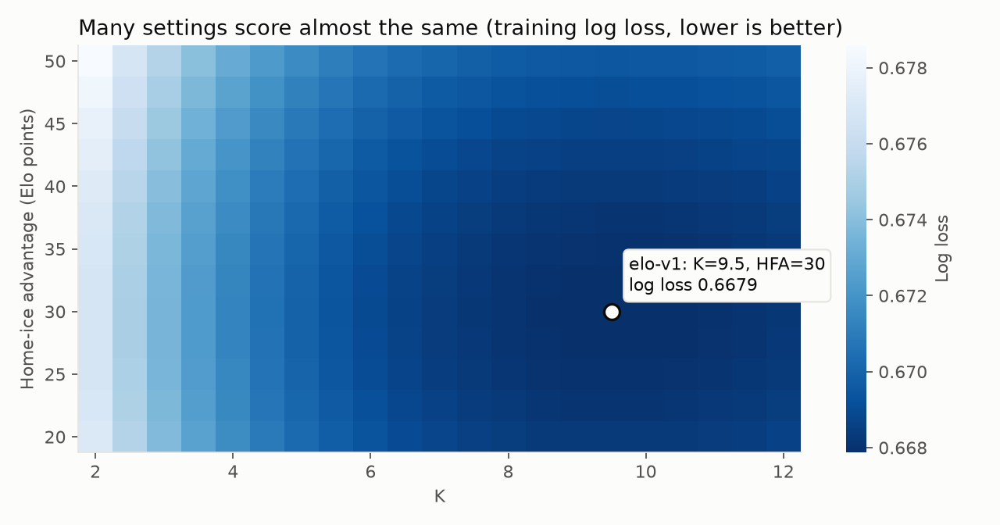

# Results log

Key decisions and results, recorded when they happen. Later changes get a dated note; logged results are not rewritten.

## Data (2026-10-26)

- 2015-16 to 2026-27: 14,856 regular-season and 996 playoff games. Every season matches its official game count.
- Home-win rate by season ranges from 0.522 to 0.563 (training average 0.541).
- OT/SO games are close to a coin flip for the home team: home-ice advantage shows up mostly in regulation.

## Elo baseline

### Decision: test goal margin as an Elo variant (2026-11-01)

Added `ln(margin + 1)` as an optional multiplier on Elo rating updates. It changes how far ratings move after a game, not what is predicted. Tested before the 2025-26 test run so it can still be compared fairly.

Training seasons only (2016-17 to 2023-24, 9,658 games), each version tuned separately:

| Version | K | HFA | Log loss | Brier | Accuracy |
|---|---|---|---|---|---|
| Constant home-win rate | | | 0.6897 | 0.2483 | 54.1% |
| Plain Elo | 9.5 | 30 | 0.6679 | 0.2376 | 58.9% |
| Margin | 8.0 | 30 | 0.6661 | 0.2368 | 59.3% |
| Margin + favorite adjustment | 8.5 | 30 | 0.6664 | 0.2370 | 59.2% |

- Margin vs plain: -0.0018 log loss (95% CI -0.0025 to -0.0010), better in all 8 seasons.
- The favorite adjustment added nothing, so it was dropped for simplicity.
- Adopted only if it also wins on 2024-25 validation. Plain Elo stays as the reference.

### Validation: 2024-25 (2026-11-01)

1,312 games, each variant tuned on training seasons only. Difference is validation log loss vs plain.

| Variant | K | HFA | Train LL | Val LL | Brier | Accuracy | Difference (95% CI) |
|---|---|---|---|---|---|---|---|
| Constant home-win rate | | | 0.6897 | 0.6862 | 0.2465 | 56.2% | |
| Plain | 9.5 | 30 | 0.6679 | 0.6683 | 0.2379 | 59.0% | reference |
| Margin | 8.0 | 30 | 0.6661 | 0.6681 | 0.2378 | 58.8% | -0.0002 (-0.0023 to +0.0018) |
| No playoffs | 9.5 | 30 | 0.6678 | 0.6680 | 0.2378 | 58.8% | -0.0003 (-0.0013 to +0.0006) |
| Regress 1/4 | 9.0 | 30 | 0.6677 | 0.6684 | 0.2380 | 58.8% | +0.0000 (-0.0009 to +0.0010) |
| Regress 1/2 | 11.0 | 30 | 0.6686 | 0.6692 | 0.2383 | 59.3% | +0.0009 (-0.0007 to +0.0025) |
| 2020-21 own HFA (25) | 9.5 | 30 | 0.6679 | 0.6683 | 0.2379 | 59.0% | +0.0000 |
| Tune without 2020-21 | 9.5 | 30 | 0.6679 | 0.6683 | 0.2379 | 59.0% | +0.0000 |

- No variant clearly beats plain on validation. Margin's training gain was not confirmed, though one season cannot rule it out.
- The no-crowds season needs no special handling: its best HFA (25) is close to the normal 30.

### Decision: freeze plain Elo as elo-v1 (2026-11-01)

K=9.5, HFA=30, regress 1/3, playoffs included, one shared HFA. No variant had a validation interval clearly below zero, which was the agreed rule for adopting one. Margin runs as a shadow model once live predictions start and is promoted only if it beats Elo on live log loss.

### Test: 2025-26, run once (2026-11-01, commit ab3df3f)

1,312 games. The model was frozen before this run and is not tuned on this result.

| Model | Log loss | Brier | Accuracy |
|---|---|---|---|
| elo-v1 | 0.6901 | 0.2484 | 53.3% |
| Constant home-win rate | 0.6929 | 0.2499 | 52.2% |
| Coin flip | 0.6931 | 0.2500 | 52.2% |

- elo-v1 vs constant: -0.0028 (95% CI -0.0113 to +0.0055), so Elo did not clearly beat the baseline this season.
- Worst scored season so far, well outside the 0.654-0.682 seen from 2016-17 to 2024-25. Data checks found no error: every team played 82 games and ratings carried over correctly.
- 2025-26 was unusually hard to predict from the past. Last season's points predicted this season's far less than usual (correlation 0.22, against 0.53-0.76 in the previous six seasons), and teams finished closer together (points-percentage SD 0.079, against 0.089-0.122). Florida, Winnipeg and Toronto opened among the top 4 Elo ratings and finished with 84, 82 and 78 points.
- Elo trailed the baseline from October to January, then beat it from February to April as ratings caught up (0.648, 0.690 and 0.669, against 0.687, 0.696 and 0.689).
- A single season can swing log loss by 0.02 or more, so live results need to be read against that range.

Correction (2026-11-01): the entry above overstated carry-over as the cause. 2017-18 had lower carry-over (0.18) and Elo still scored 0.672. Across the 10 scored seasons, Elo's log loss tracks how far apart teams finished (correlation -0.93) much better than carry-over (-0.64). Spread alone predicts about 0.683 for 2025-26 against the actual 0.690, so low carry-over may add to it. Both are measured from 10 seasons and spread is only known after a season, so this explains results but does not forecast them.

### Figures

Elo's score follows team spread: closer seasons are harder to predict.

Probabilities were reliable through 2024-25. The 2025-26 line is noisier, with fewer games per bin. Bins under 30 games are omitted.

The score is flat around the chosen settings and depends far more on K than on HFA, so exact values matter little.

## Live predictions

### Go-live (2026-11-09)

- The first official predictions were written at 01:28 UTC on 2026-11-09 by a manual workflow run: 3 games, NYR @ EDM, PHI @ VAN and NYI @ SJS, each predicted by elo-v1 (primary) and elo-margin-v1 (shadow).
- The live record starts here. The 278 regular-season games already played in 2026-27, and PIT @ ANA (already under way at the time of the run), have no official prediction.
- From now on, the GitHub Actions workflow runs at 14:00 and 16:00 UTC, capturing CA and US betting odds on each run.
